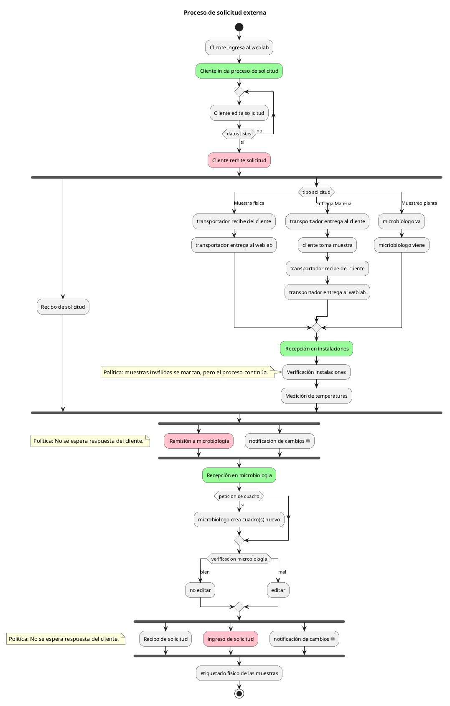
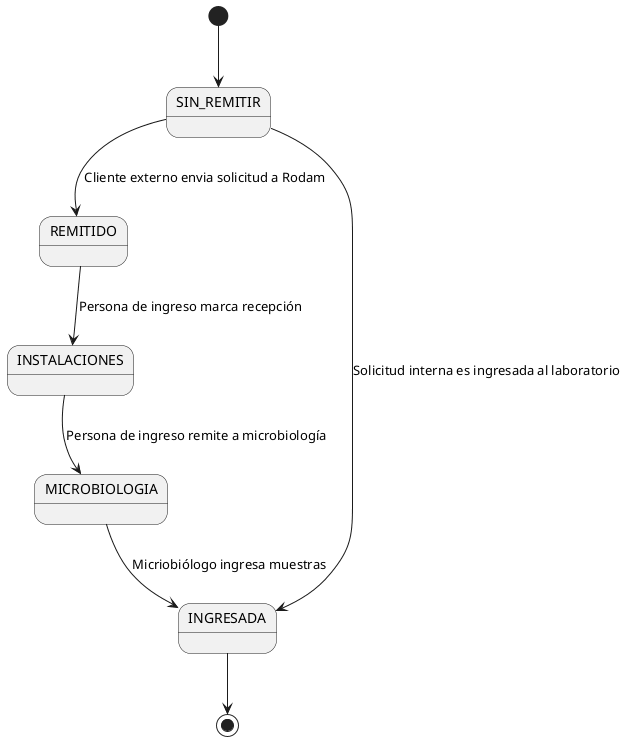

######################
Solicitudes Externas
######################

:author: Jonatan Ahumada Fernández
:contact: box@jade.lat
:date: primera versión 2026-10-14, último build |date|

.. contents::

Descripción general
------------------

Las solicitudes externas son un proceso del WebLab que permite a los
clientes de Rodam Análisis (cliente externo) generar solicitudes de
análisis directamente en la aplicación. El proceso comprende desde el
momento en que el cliente inicia el diligenciamiento de la solicitud
hasta que las muestras son ingresadas por los microbiólogos, desde
donde continúan el flujo habitual del WebLab.

El objetivo de este componente es trasladar al cliente una parte
importante del trabajo de preparación de las solicitudes, aprovechando
la capacidad de autogestión que ofrece el sistema y los cargos creados
para representar a los clientes, en particular Cliente y Cliente
Maestro.

Sin embargo, las solicitudes externas no consisten simplemente en
exponer los formularios de las solicitudes internas a un usuario
externo. El proceso involucra una cantidad considerable de información,
actores con responsabilidades diferentes y circunstancias que no
siempre pueden resolverse en el momento del diligenciamiento. Por
ejemplo, un cliente puede conocer las características de la muestra
que necesita analizar, pero no disponer de la información suficiente
para asignarle un cuadro analítico.

Por lo tanto, el sistema debe ofrecer algo más que un mecanismo para
recopilar datos. Debe proporcionar una representación concreta del
proceso de negocio, facilitar la colaboración entre los actores y
conservar un registro auditable de las decisiones y modificaciones
que ocurren durante el ingreso de las muestras.

El proceso se apoya en varios componentes del WebLab: formularios,
estados, anotaciones, validaciones, notificaciones, recibos y registros
de auditoría. Estos componentes tienen responsabilidades diferentes,
pero deben funcionar de manera coordinada para que el proceso pueda
ser comprendido y gestionado por los usuarios internos y externos.

Este es un diagrama resumen del proceso. Su propósito es ubicar
rápidamente al lector dentro todo el proceso:

Necesidad
---------

El desarrollo de las solicitudes externas responde a cinco necesidades
principales:

1. Reducir la fatiga del diligenciamiento.

   La solicitud requiere ingresar una cantidad considerable de datos
   por cada muestra. Solicitar toda esta información en un único
   formulario aumenta la carga cognitiva del usuario y hace más
   probable que se presenten errores.

2. Ofrecer una propuesta de valor al cliente.

   El cliente debe tener motivos para iniciar y completar la solicitud
   por su cuenta. No basta con trasladarle una tarea que anteriormente
   realizaba el personal del laboratorio. La experiencia de usuario
   debe facilitar el diligenciamiento y ofrecer beneficios adicionales
   que le permitan conocer el estado de sus solicitudes y actuar
   cuando sea necesario.

3. Resolver la incertidumbre durante el diligenciamiento.

   El cliente no siempre dispone de la información necesaria para
   completar una solicitud, especialmente cuando debe seleccionar o
   solicitar un cuadro analítico. El sistema debe permitir que estas
   situaciones se comuniquen y se resuelvan durante el proceso, sin
   obligar al cliente a tomar decisiones técnicas para las cuales no
   necesariamente dispone de los conocimientos requeridos.

4. Sintetizar el proceso de negocio.

   En el proceso intervienen clientes, transportadores, personal de
   ingreso y microbiólogos. Cada actor participa en circunstancias
   diferentes y tiene una perspectiva particular del trabajo. El
   sistema debe ofrecer una representación común del proceso y
   permitir reconstruir el trayecto de cada muestra.

5. Prevenir y gestionar los errores de diligenciamiento.

   La cantidad de datos y la incertidumbre sobre algunos de ellos
   hacen probable que se presenten errores u omisiones. Es necesario
   establecer puntos de validación que ayuden al usuario a identificar
   y corregir estos problemas, conservando un registro de los cambios
   realizados.

Dificultades de diseño
----------------------

1. ¿Cómo reducir la fatiga sin simplificar artificialmente el proceso?

   No es posible eliminar la necesidad de diligenciar los datos que
   requiere el laboratorio. La solución consiste en descomponer el
   proceso en pasos más pequeños, cada uno con un formulario
   específico. Esto permite que el usuario avance incrementalmente y
   que cada paso incorpore validaciones y mejoras de usabilidad
   acordes con sus necesidades.

   La descomposición también permite refinar el proceso de manera
   progresiva. En lugar de intentar resolver todos los problemas de
   diligenciamiento mediante una solución única, cada formulario
   puede mejorarse a partir de las dificultades que se identifiquen
   durante su utilización.

2. ¿Cómo permitir que el cliente solicite un análisis sin disponer
   de toda la información técnica?

   La asignación de cuadros analíticos constituye uno de los
   principales puntos de incertidumbre para el cliente externo.

   Para atender esta dificultad se introduce un sistema de
   anotaciones. Mediante ellas, el cliente puede expresar en sus
   propias palabras qué necesita, qué información desconoce o qué
   circunstancias deben tenerse en cuenta.

   Estas anotaciones proporcionan contexto al personal del laboratorio
   para tomar decisiones informadas durante las etapas posteriores.
   En particular, los microbiólogos conservan la responsabilidad de
   decidir si las muestras pueden ser ingresadas o si deben quedar
   suspendidas mientras se resuelve alguna dificultad.

3. ¿Cómo representar un proceso que involucra múltiples actores?

   La solución debe permitir que cada actor conozca las acciones
   realizadas y las responsabilidades asociadas a cada cambio. Para
   ello, se combinan estados que representan las etapas del proceso
   con registros de auditoría que permiten reconstruir los cambios
   particulares de cada solicitud.

   Los estados ofrecen una representación resumida del avance,
   mientras que la auditoría conserva el detalle de los
   acontecimientos. Las notificaciones y los recibos complementan
   estos mecanismos, proporcionando información adecuada para el
   usuario que la necesita.

4. ¿Cómo prevenir errores sin impedir que el proceso avance?

   El sistema incorpora puntos de validación (*checkpoints*) que
   orientan al usuario durante el diligenciamiento y permiten detectar
   problemas antes de que la solicitud avance a determinadas etapas.

   Las validaciones deben refinarse incrementalmente, atendiendo a
   las circunstancias particulares de cada paso. Además, se debe
   permitir la corrección de la solicitud antes de su ingreso,
   procurando conservar un rastro auditable de las modificaciones.

5. ¿Cómo mantener un registro verificable de los cambios?

   El registro de auditoría no debe limitarse a indicar que un objeto
   fue modificado. Para comprender lo sucedido, es necesario conocer
   los valores anteriores y posteriores, el responsable del cambio y,
   cuando corresponda, el motivo que lo justifica.

   Esta información debe poder consultarse desde la aplicación y
   utilizarse para construir documentos que comuniquen los cambios
   relevantes al cliente. La implementación debe apoyarse en los
   mecanismos de auditoría del WebLab, evitando mantener registros
   paralelos que puedan divergir de los datos reales.

Decisión de diseño
------------------

1. Descomposición incremental del diligenciamiento.

   El proceso se divide en pasos pequeños, cada uno con un formulario
   específico. El diseño de cada paso debe considerar las validaciones
   necesarias, la información disponible y las dificultades
   particulares del usuario.

   Esta decisión permite mejorar la experiencia de usuario sin
   renunciar a la información que necesita el laboratorio. También
   evita que la solución dependa de encontrar una única estrategia
   que resuelva todos los problemas de diligenciamiento.

2. Asistencia mediante anotaciones.

   Se establece un mecanismo general para que los actores puedan
   dejar constancia de solicitudes, información faltante,
   inconformidades y otras circunstancias relevantes.

   Las anotaciones permiten separar la expresión de una necesidad
   de la decisión técnica que debe tomar el personal del laboratorio.
   De este modo, el cliente puede describir su requerimiento sin que
   el sistema le atribuya responsabilidades que corresponden al
   experto del dominio.

   Las anotaciones también sirven como base para identificar
   situaciones que requieren una acción posterior. Las notificaciones
   comunican al cliente cuándo debe intervenir, mientras que el
   personal responsable determina qué acciones permiten continuar
   el proceso.

3. Representación explícita del ciclo de vida.

   El proceso se representa mediante estados que reflejan las
   principales etapas por las que atraviesa una solicitud. Los
   cambios de estado deben corresponder a acontecimientos concretos
   del proceso de negocio y a las responsabilidades de los actores.

   El ciclo de vida se define iterativamente entre Rodam Análisis y
   el desarrollador. Aunque el diseño debe admitir cierta flexibilidad,
   el proceso acordado debe respetarse después del despliegue para
   asegurar el funcionamiento coherente del WebLab.

4. Auditoría y comunicación de cambios.

   El sistema conserva información auditable de las modificaciones
   realizadas durante el proceso. Los usuarios internos necesitan
   consultar el historial para comprender las decisiones tomadas,
   mientras que el cliente externo requiere una representación
   limitada a la información que le corresponde conocer.

   Las notificaciones y los recibos se construyen a partir de esta
   información, de modo que el cliente pueda conocer los cambios
   relevantes sin necesidad de inspeccionar directamente el registro
   interno completo.

5. Validaciones y corrección previa al ingreso.

   La solicitud debe poder corregirse durante su preparación, hasta
   donde lo permitan las reglas del negocio. Las validaciones se
   ejecutan en los puntos pertinentes del proceso y deben considerar
   que ciertos datos pueden cambiar después de haber sido revisados.

   Por esta razón, las condiciones necesarias para avanzar deben
   verificarse nuevamente cuando se ejecuta la acción correspondiente,
   en lugar de confiar exclusivamente en validaciones efectuadas en
   un momento anterior.

Entorno
-------

Las solicitudes externas son una funcionalidad del WebLab y utilizan
sus mecanismos de autenticación, autorización, persistencia, auditoría
y presentación de información.

El proceso comienza con la intervención de un cliente externo y
continúa con la participación de los actores internos responsables
de recibir, inspeccionar y procesar las muestras. Los componentes
más relevantes para comprender su funcionamiento son los siguientes.

1. **Solicitud.** Representa el conjunto de información que el cliente
   diligencia y remite al laboratorio. Su ciclo de vida permite
   distinguir la preparación de la solicitud de las etapas posteriores
   a su remisión.

2. **Muestras solicitadas.** Representan las muestras incluidas en la
   solicitud y permiten relacionar los datos particulares de cada
   muestra con el proceso general. Las circunstancias de una muestra
   pueden requerir decisiones específicas sin que ello implique
   perder la trazabilidad de la solicitud.

3. **Anotaciones.** Permiten asociar observaciones y solicitudes a los
   objetos relevantes del proceso. Su diseño utiliza una relación
   genérica con el objeto anotado, lo que permite reutilizar el
   mecanismo para distintas clases de objetos.

4. **Auditoría.** Conserva la historia de las modificaciones y permite
   consultar los valores anteriores y posteriores. Esta información
   es necesaria tanto para la inspección interna como para construir
   comunicaciones dirigidas al cliente.

5. **Notificaciones.** Comunican los acontecimientos relevantes del
   proceso y las situaciones que requieren la intervención del cliente.
   Su propósito es mantener informado al usuario sin exigirle que
   consulte continuamente la aplicación.

6. **Recibo de recepción.** Proporciona un documento descargable que
   deja constancia de la solicitud remitida. Su contenido puede
   incluir los cambios y las observaciones relevantes producidos
   durante las etapas posteriores del proceso.

Estos componentes no son independientes en términos funcionales.
La solicitud proporciona el contexto general; las muestras y las
anotaciones representan circunstancias particulares; la auditoría
permite reconstruir los cambios; y las notificaciones y los recibos
comunican una parte de esta información a los usuarios.

Modelo de anotaciones
---------------------

Las anotaciones son un mecanismo transversal del proceso de
solicitudes externas. Su finalidad es registrar información que no
puede expresarse adecuadamente mediante los atributos estructurados
de una muestra o una solicitud.

El modelo contempla, entre otras, las siguientes clases de anotación:

- Petición de servicio.
- No conformidad con cambios.
- Falta de información.
- Inspección visual.
- Otro.

La anotación conserva información como su creador, fecha de creación,
estado y contenido. La relación con el objeto anotado se representa
mediante un tipo de contenido y un identificador de objeto, de manera
que el mecanismo pueda asociarse a diferentes clases de objetos.

Este diseño evita limitar las anotaciones exclusivamente a las
muestras solicitadas. También permite que la funcionalidad evolucione
a medida que se identifiquen nuevas necesidades de comunicación y
trazabilidad.

En el caso de las solicitudes externas, las anotaciones cumplen
varias funciones:

1. Permiten al cliente expresar una necesidad que no puede resolver
   mediante la información disponible en los formularios.

2. Proporcionan al personal del laboratorio contexto para decidir
   cómo proceder con una muestra.

3. Permiten dejar constancia de información faltante, confusa o
   incorrecta.

4. Sirven como fundamento para comunicar al cliente las acciones
   que debe realizar.

5. Contribuyen a reconstruir las circunstancias que rodearon una
   decisión o una modificación.

Las anotaciones no sustituyen las decisiones técnicas del laboratorio.
En particular, describir una necesidad o solicitar un servicio no
implica que el cuadro analítico correspondiente haya sido aprobado
ni que la muestra pueda ingresar automáticamente.

Ciclo de vida de la solicitud
-----------------------------

El ciclo de vida establece las etapas por las que atraviesa una
solicitud y las transiciones que permiten avanzar entre ellas.

El diseño debe distinguir las solicitudes externas de las internas,
pues no todas comienzan en el mismo punto del proceso. Una solicitud
externa se prepara y remite por parte del cliente, mientras que una
solicitud interna puede ingresar al laboratorio sin que el cliente
haya utilizado previamente el mecanismo de autogestión.

Para el release del 7 de enero de 2026 se reportó el siguiente ciclo
de vida:

- ``SIN-REMITIR``: la solicitud se encuentra en preparación y todavía
  no ha sido remitida por el cliente externo.
- ``REMITIDA``: el cliente ha enviado la solicitud al laboratorio.
- ``INSTALACIONES``: la solicitud se encuentra en la etapa de
  recepción e inspección en instalaciones.
- ``MICROBIOLOGIA``: la solicitud ha sido remitida al área de
  microbiología.
- ``INGRESADA``: los microbiólogos han ingresado las muestras y estas
  continúan el flujo habitual del WebLab.

El siguiente diagrama resume el flujo principal previsto:

Las solicitudes internas siguen una trayectoria diferente: pueden
pasar directamente al estado ``INGRESADA`` cuando son ingresadas al
laboratorio por el personal correspondiente.

El ciclo de vida no debe confundirse con el registro de auditoría.
El primero indica la etapa general del proceso; el segundo permite
conocer los acontecimientos y las modificaciones concretas que han
ocurrido dentro de cada etapa.

La documentación de desarrollo también plantea la necesidad de un
estado ``DESCARTADO``. Su inclusión y las condiciones exactas de
transición deben confirmarse en el modelo de proceso vigente. No debe
asumirse que forma parte del ciclo de vida reportado para el release
mencionado.

Flujo de recepción en instalaciones
-----------------------------------

La recepción en instalaciones constituye una etapa de verificación
de las muestras recibidas. Durante ella, el personal responsable
puede comprobar las condiciones físicas y documentales de las
muestras y registrar circunstancias que deban tenerse en cuenta
antes de su procesamiento en microbiología.

Entre los elementos contemplados para la inspección se encuentran:

- La temperatura de las muestras.
- El etiquetado.
- Las observaciones derivadas de la inspección visual.
- Las circunstancias que impiden procesar una muestra.

El resultado de la inspección puede dar lugar a anotaciones asociadas
a las muestras correspondientes. Por ejemplo, una muestra física que
no llegó al laboratorio o una petición de cuadro insuficiente pueden
requerir una observación específica.

El proceso debe conservar la posibilidad de continuar con la recepción
de las demás muestras cuando alguna presente una no conformidad.
Esto permite distinguir el avance general de la solicitud de la
situación particular de cada muestra.

La documentación de diseño contempla que las muestras inválidas
se marquen durante la recepción y que no sean procesadas en
microbiología mientras se encuentren en esa condición. El tratamiento
posterior debe comunicarse al cliente mediante las anotaciones y
notificaciones pertinentes.

Esta separación permite mantener un registro del recorrido de la
solicitud sin interpretar que todas sus muestras necesariamente
pueden procesarse en las mismas condiciones.

Validaciones
------------

Las validaciones tienen como propósito prevenir errores de
diligenciamiento y evitar que una solicitud avance cuando no satisface
las condiciones necesarias para la etapa correspondiente.

No se plantea una validación única que resuelva todos los problemas.
En su lugar, las validaciones se incorporan en diferentes puntos
del proceso, de acuerdo con las circunstancias de cada paso.

Esta estrategia tiene dos consecuencias:

1. Los formularios pueden ofrecer orientación específica antes de que
   el usuario complete una acción.

2. Las reglas relevantes deben comprobarse nuevamente cuando se
   ejecuta la transición que depende de ellas.

La segunda consecuencia es especialmente importante cuando una
decisión puede cambiar después de haber sido tomada. Por ejemplo,
que una solicitud haya sido revisada o cerrada no garantiza que los
cuadros analíticos continúen correctamente asignados en el momento
de su remisión.

Por ello, las condiciones necesarias para remitir la solicitud deben
verificarse en tiempo de ejecución. El sistema no debe depender
exclusivamente de una validación anterior para asumir que el estado
de los datos permanece inalterado.

Existe una cuestión de diseño que debe distinguirse de esta decisión
general: si basta con que el cuadro esté asignado o si también debe
estar aprobado por calidad para permitir el cierre de una petición.
Esta condición debe resolverse de acuerdo con las reglas de negocio
vigentes.

Las validaciones deben evolucionar progresivamente, a partir de las
situaciones observadas durante el uso del sistema. Su finalidad no es
impedir arbitrariamente el avance, sino hacer explícitas las
condiciones que deben satisfacerse y facilitar su corrección.

Auditoría
---------

El sistema debe permitir reconstruir el trayecto de cada solicitud,
identificando los cambios realizados y los responsables de ejecutarlos.

La auditoría cumple dos funciones relacionadas, pero diferentes:

1. **Trazabilidad interna.** Permite a los actores del laboratorio
   comprender las modificaciones efectuadas, las decisiones tomadas
   y las circunstancias que rodearon cada acontecimiento.

2. **Comunicación externa.** Permite presentar al cliente la
   información relevante sobre los cambios que afectan a su solicitud
   y a sus muestras.

La representación de un cambio debe permitir distinguir, cuando
corresponda, el valor anterior del valor posterior. También debe
conservar el contexto necesario para comprender el motivo de la
modificación.

El historial de auditoría debe poder consultarse desde la aplicación.
No es suficiente con conservar los cambios internamente si los
usuarios responsables no disponen de una forma práctica de
inspeccionarlos.

Para la consulta externa se establece un alcance más limitado: el
cliente debe poder conocer la información auditable de sus propias
solicitudes, sin que ello implique exponer todo el historial interno
del laboratorio.

Esta distinción permite que el sistema utilice una base común de
trazabilidad sin confundir las necesidades de consulta de los actores
internos con las del cliente.

Notificaciones y recibos
------------------------

Las notificaciones y los recibos son mecanismos complementarios para
comunicar el estado y la historia de una solicitud.

Notificaciones
~~~~~~~~~~~~~~

El WebLab debe soportar notificaciones por correo electrónico para
comunicar al cliente los avances relevantes de sus solicitudes.

Su finalidad no es reproducir toda la información disponible en la
aplicación, sino informar de los acontecimientos que requieren
atención o que resultan relevantes para comprender el proceso.

En particular, las notificaciones pueden servir para:

- Comunicar avances de la solicitud.
- Informar sobre cambios realizados durante la recepción.
- Dar a conocer anotaciones que requieren la intervención del cliente.
- Informar sobre circunstancias que afectan al procesamiento de
  determinadas muestras.

Las notificaciones deben apoyar el proceso de autogestión. Por esta
razón, el sistema no debe asumir que el cliente responderá a cada
comunicación: el proceso debe representar explícitamente las acciones
que se esperan del cliente y las que corresponden al laboratorio.

Recibo de recepción
~~~~~~~~~~~~~~~~~~~

El recibo de recepción es un documento descargable que deja
constancia de la solicitud remitida por el cliente.

El diseño contempla un único recibo de recepción para la solicitud,
generado y disponible cuando el cliente la remite. Las notificaciones,
por su parte, pueden producirse en distintos momentos del ciclo de
vida.

El recibo debe poder comunicar los cambios relevantes que ocurran
durante las etapas posteriores. Por ejemplo, puede mostrar valores
anteriores y posteriores de los datos modificados, así como las
anotaciones relacionadas con muestras que no puedan procesarse.

La información debe permitir al cliente comprender qué cambió y
qué consecuencias tiene para su solicitud. No es necesario reproducir
en cada notificación todo el historial, siempre que la información
auditable pertinente pueda consultarse también en la aplicación.

Desde el punto de vista de diseño, el recibo de recepción sigue un
patrón de construcción compartido con otros documentos del WebLab,
en particular con el certificado de emisión. El objetivo es reutilizar
las capacidades comunes de generación documental y concentrar en el
recibo la lógica específica de presentación de los datos de la
solicitud.

La representación concreta del documento debe mantener la distinción
entre los cambios efectuados y las observaciones registradas durante
la recepción, pues ambas clases de información tienen significados
diferentes para el cliente.

Solicitudes internas
--------------------

La incorporación de solicitudes externas no debe eliminar ni
interrumpir el soporte para las solicitudes internas.

El WebLab debe permitir que el laboratorio continúe gestionando
solicitudes por sus mecanismos internos, incluso cuando el cliente
no utiliza la funcionalidad de autogestión.

Obligar al cliente a utilizar las solicitudes externas no constituye
un requisito del diseño. El proceso debe admitir que el personal del
laboratorio prepare una solicitud internamente cuando las
circunstancias lo requieran.

Del mismo modo, las muestras que lleguen a instalaciones sin una
solicitud externa previamente creada deben poder gestionarse mediante
el procedimiento interno correspondiente.

Esta decisión evita que la introducción de un nuevo canal de ingreso
se convierta en una dependencia obligatoria para el funcionamiento
del laboratorio. Las solicitudes externas amplían las capacidades del
WebLab, pero no sustituyen los procesos internos que siguen siendo
necesarios.

Atributos de diseño
-------------------

1. Modularidad

   El proceso se descompone en componentes con responsabilidades
   diferenciadas: formularios, anotaciones, estados, validaciones,
   auditoría, notificaciones y recibos.

   Esta separación permite evolucionar cada componente atendiendo a
   sus necesidades particulares. Por ejemplo, las reglas de
   validación de un paso pueden refinarse sin que ello implique
   rediseñar necesariamente el mecanismo de notificaciones.

   La modularidad también permite reutilizar mecanismos generales,
   como las anotaciones asociadas a distintos objetos y las
   capacidades compartidas de generación documental.

2. Progresividad

   Las solicitudes externas se diseñan para admitir mejoras
   incrementales. La cantidad de información requerida y la variedad
   de circunstancias del proceso hacen poco probable que todas las
   necesidades puedan resolverse de manera definitiva desde la
   primera versión.

   Por ello, los formularios, las validaciones y las reglas del
   proceso deben poder refinarse a partir de la experiencia de uso.

   Esta progresividad no elimina la necesidad de definir un ciclo de
   vida coherente. La flexibilidad debe existir en el diseño y en la
   capacidad de evolución, sin convertir el proceso desplegado en una
   secuencia arbitraria de estados y transiciones.

3. Trazabilidad

   Las decisiones y modificaciones deben dejar un rastro que permita
   comprender el trayecto de cada solicitud y de sus muestras.

   La combinación de estados, anotaciones y auditoría permite
   representar diferentes niveles de detalle: desde la etapa general
   de una solicitud hasta las circunstancias particulares que
   explican una modificación.

   La trazabilidad es necesaria tanto para la operación interna como
   para comunicar al cliente lo sucedido durante la recepción.

4. Separación de responsabilidades

   El cliente puede describir lo que necesita y proporcionar la
   información que conoce, pero no necesariamente dispone de los
   conocimientos técnicos para resolver todas las cuestiones
   relacionadas con el análisis.

   El sistema debe facilitar la comunicación de estas necesidades
   sin trasladar al cliente las decisiones que corresponden al
   personal experto del laboratorio.

   En particular, la intervención del cliente y la decisión técnica
   de ingreso deben conservarse como responsabilidades diferenciadas.

5. Verificación en tiempo de ejecución

   Las condiciones necesarias para avanzar deben comprobarse en el
   momento en que se ejecuta la acción correspondiente, especialmente
   cuando los datos pueden cambiar entre una validación y otra.

   Esta propiedad evita que el sistema confíe exclusivamente en
   verificaciones realizadas durante etapas anteriores y contribuye
   a mantener la coherencia del proceso.

6. Comunicación orientada al usuario

   El sistema utiliza estados, notificaciones y recibos para que los
   actores comprendan el avance de la solicitud y las acciones que
   les corresponden.

   Estos mecanismos no sustituyen la información auditable, sino que
   presentan sus aspectos relevantes de acuerdo con las necesidades
   de cada usuario.

Dificultades operacionales
--------------------------

El diseño de las solicitudes externas debe considerar que la
funcionalidad no termina con el diligenciamiento de los formularios.
También debe conservar la coherencia entre los datos, el ciclo de
vida, las notificaciones y los documentos generados.

Entre las dificultades operacionales identificadas se encuentran:

1. Cambios posteriores a una validación.

   Los datos, de forma general, pueden cambiar a lo largo del
   proceso. Por eso, la responsabilidad de la validación en las
   transiciones se torna alta. Este es un intercambio de diseño.
   
2. Corrección de datos con trazabilidad.

   Permitir la edición de la solicitud antes de su ingreso reduce el
   impacto de los errores de diligenciamiento, pero exige conservar un
   historial verificable de los cambios realizados. Esto expone a.l
   cliente externo a información de la que antes no disponía 

3. Generación documental.

   Los recibos deben generarse correctamente y presentar la
   información correspondiente al momento de su emisión, sin confundir
   los datos originales con las modificaciones posteriores.  La
   comparación entre versiones de un documento se transforma en una
   tarea de esfuerzo humano. 

4. Alcance de las anotaciones.

   El sistema de anotaciones, al nacer de la necesidad de gestionar
   imprevistos tienen un alcance difícil de estimar. Además, como la
   funcionalidad contempla en algunas ocasiones que el cliente externo
   responda a ellas incorporan necesariamente una dimensión por fuera
   del control directo de los usuarios internos.

5. Ciclo de vida de las anotaciones.

   Las anotaciones, al ser comentarios sobre imprevistos
   requieren que ellas mismas estén sujetas a algún tipo de
   trazabilidad. Sin embargo, someterlas al ciclo de vida habitual de
   SIN-REMITIR - REMITIDA - CERRADA se tornaría excesivamente tedioso
   para el usuario que decide anotar una muestra dentro del ya
   complejo proceso de una solicitud.

   Por eso motivo, las anotaciones reciben auditoría, pero mantienen
   el ciclo de vida simple (ABIERTA - CERRADA). 

